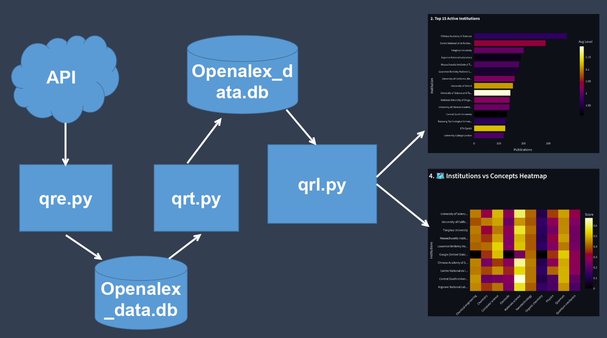
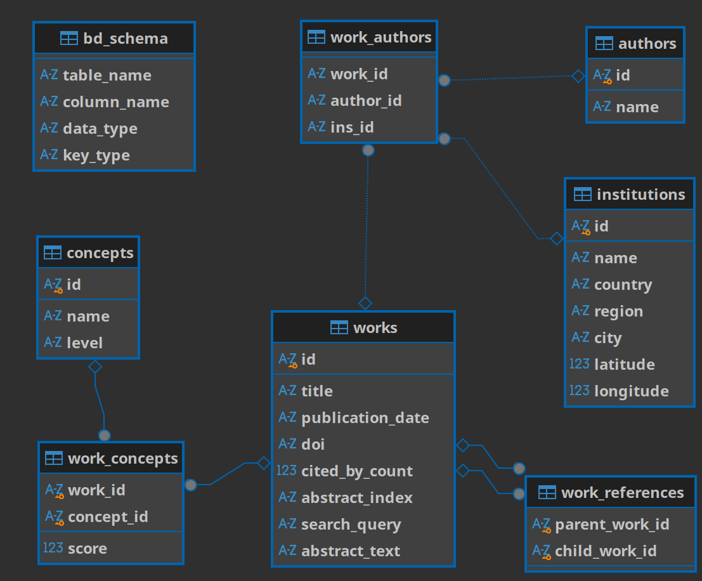
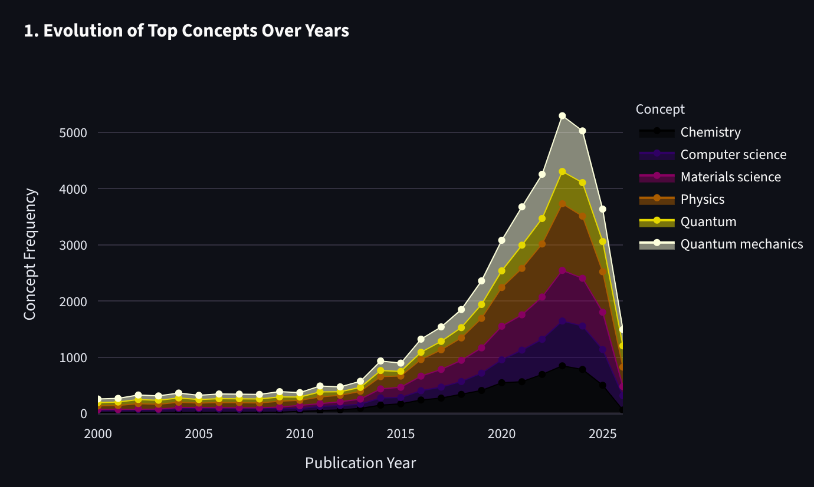
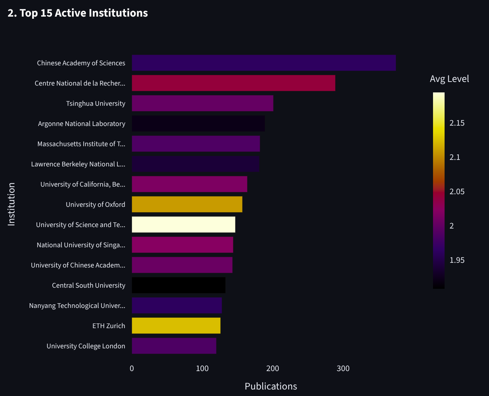
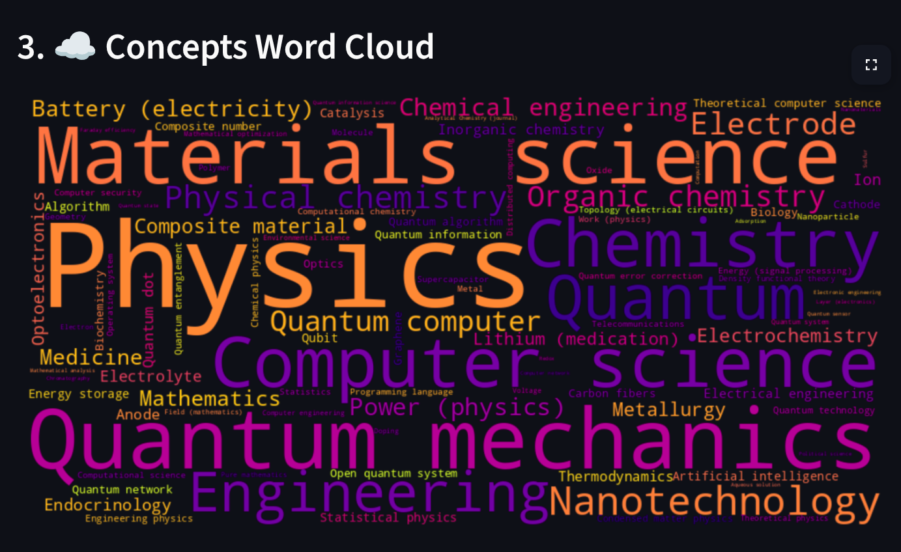
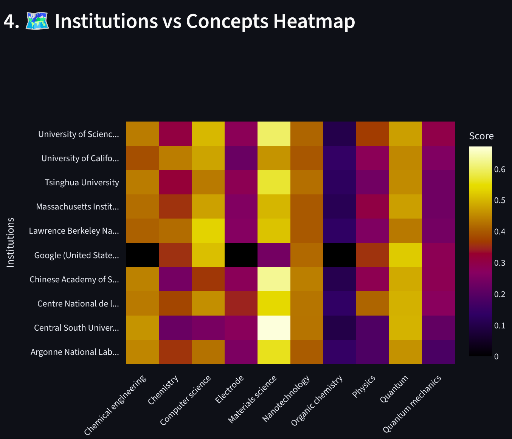

# OpenAlex API Research Pipeline Project
## 📖 Storytelling & Origin
As a recent B.Sc. Physics graduate with a focus on theoretical and computational physics, my ambition is to pursue advanced graduate studies in quantum computing and quantum battery dynamics. Engaging in active research requires more than just reading papers; it demands a strategic understanding of global scientific trends. I needed a way to track how specific quantum concepts are evolving, identify which global institutions are leading these advancements, and evaluate my best academic destinations. Furthermore, reconstructing and analyzing literature abstracts in bulk is critical for pinpointing exact research gaps.
This necessity birthed the OpenAlex API Research Pipeline. Simultaneously, this project serves as my capstone graduation project for the Python for Everybody Specialization from the University of Michigan (Coursera).
## 🏗️ Architecture (ETL Pipeline)
This project follows a strict Extract, Transform, Load (ETL) architecture to ensure data integrity and performance.
**
 * Extract: Pulling raw JSON data from the OpenAlex API.
 * Transform: Cleaning, normalizing, and structuring the data locally.
 * Load & Visualize: Serving the refined data through an interactive frontend.
🧰 The Stack
 * requests: Handles the HTTP calls to the OpenAlex API with pagination and rate-limit management.
 * sqlite3: Manages the local relational database, executing complex joins and enforcing schema constraints.
 * pandas: Powers the in-memory data manipulation, filtering, and merging for the visualization layer.
 * streamlit: Serves as the rapid web framework to render the interactive dashboard and UI components.
 * plotly: Generates the dynamic, interactive charts (area plots, bar charts, heatmaps) for data exploration.
 * wordcloud: Renders visual text summaries of the most frequently occurring research concepts.
## 🔄 Data Workflow
The pipeline is divided into three dedicated Python scripts to separate concerns and maximize efficiency:
 * Extraction (qre.py): Establishes the API connection, dynamically creates the normalized relational tables (if they do not exist), and executes an automated loop to fetch paginated data. It securely parses authors, institutions, concepts, and references, mapping them into the database while avoiding duplicates.
 * Transformation & Cleaning (qrt.py): Scrubs the raw database. It strips URL prefixes to isolate pure entity IDs, standardizes publication date formats, removes orphaned relationships, and reconstructs inverted-index JSON abstracts into fully readable text blocks for literature review.
 * Loading & Visualization (qrl.py): Connects to the optimized SQLite database, applies user-selected filters (search queries and year ranges) via Pandas, and dynamically renders the analytical dashboard without re-querying the external API.

## ✨ Features
 * Fault-Tolerant Scraping: Resumes downloads from exact checkpoints without duplicating data if the API rate limit is hit or the connection drops.
 * Complex Relational Mapping: Handles many-to-many relationships across 7 specialized tables.
 * Abstract Reconstruction: Automatically decodes and rebuilds fragmented OpenAlex abstracts into human-readable literature summaries.
 * Foundational Knowledge Tree: A unique algorithm that traces the historical and hierarchical roots of any scientific concept.
## 🗄️ Database Schema

## ⚙️ Installation & Setup
 * Clone the repository
   git clone https://github.com/TariqZJawad/OpenAlex-Quantum-API-Research-Pipeline-Project
   
cd openalex-quantum-explorer

 * Set up a virtual environment
   python3 -m venv venv
source venv/bin/activate

 * Install dependencies
   pip install -r requirements.txt

 * Run the pipeline
   python3 qre.py   # Extract data
python3 qrt.py   # Clean and transform
streamlit run qrl.py  # Launch the dashboard

## 📊 Data Visualizations (Rethinking the Metrics)
> [you can review the vis app by streamlit](https://openalex-quantum-api-research-pipeline-project.streamlit.app/)
1. Evolution of Top Concepts Over Years (Area Chart)
Visualizing the volume of specific concepts over time highlights the "momentum" of a research topic. This helps identify whether a niche like "Quantum Batteries" is an emerging trend, peaking, or plateauing, guiding future research focus.

3. Top Active Institutions (Horizontal Bar Chart)
By mapping publication volume against the average "Concept Level," this chart doesn't just show who publishes the most, but who publishes the most fundamental (low-level) vs. applied (high-level) research. This is directly used to shortlist potential universities for graduate studies.

4. Concepts Word Cloud
Provides an immediate, intuitive snapshot of the dominant themes within a filtered subset of papers, allowing for rapid topical orientation.

5. Institutions vs. Concepts Heatmap
This matrix precisely cross-references research hubs with specific scientific concepts. It answers the critical question: "Which exact institution should I target if I want to specialize in 'Quantum Error Correction'?"

## 🌱 The Foundational Knowledge Tree
The Knowledge Tree is a custom feature designed specifically for conducting efficient literature reviews. By searching for a core concept, the algorithm fetches the relevant papers and sorts them starting from the lowest level (the most fundamental physics) and the oldest publication_date.
It generates sequential literature boxes containing the title, authors, institutions, concept scores, and an expandable reconstructed abstract. This allows a researcher to trace the pure historical roots of an idea, read how it was initially defined, and follow its progression up to modern applications—an invaluable tool for effortlessly identifying research gaps.
## 🚀 For the Future
This project is a functional prototype for a much larger vision: the creation of a comprehensive Physics Academy. The ultimate goal is to build an educational platform structured entirely around the historical frequency and hierarchical level of scientific knowledge, teaching concepts in the exact sequence they evolved and mathematically matured in the real world.
## 🧑‍💻 Author
**Tariq Zeyad Jawad** (Villam)
 * B.Sc. in Physics, Analytics
 * 💼 LinkedIn: [Profile Link](https://www.linkedin.com/in/tariq-jawad?utm_source=share_via&utm_content=profile&utm_medium=member_android)
 * 🐙 GitHub: [Repository](https://github.com/TariqZJawad?tab=repositories)
 * ✉️ Email: tzyad3763@gmail.com
